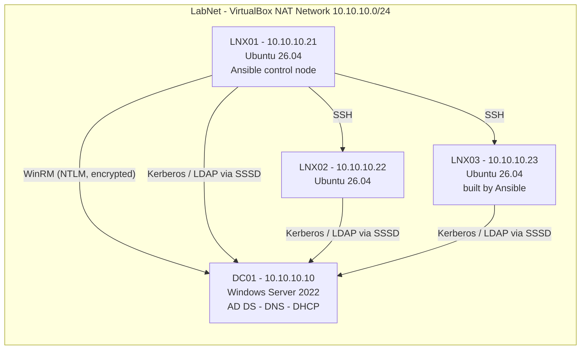

# Hybrid Linux/Windows Homelab

A virtualized enterprise-style lab built on a Windows laptop with VirtualBox: a **Windows Server 2022 domain controller** (AD DS, DNS, DHCP) and **Ubuntu 26.04 servers joined to Active Directory with SSSD**, all managed from a single **Ansible control node over SSH (Linux) and WinRM (Windows)**, plus **PowerShell automation** for user provisioning and health reporting.

## Results

| What | Manual | Automated |
|---|---|---|
| New Linux server: patched, hardened, AD-joined | ~50 min | **~20 min end to end**, with the Ansible run itself under 5 min |
| Create 8 AD users with OUs and group membership | ~15–20 min in ADUC | **1.6 seconds** from a CSV |
| Re-running any playbook or script | n/a | **Idempotent**: `changed=0` / users skipped |

## Architecture



| Host | OS | Role | IP |
|---|---|---|---|
| DC01 | Windows Server 2022 | AD DS, DNS, DHCP (scope .100–.200) | 10.10.10.10 |
| LNX01 | Ubuntu 26.04 LTS | Ansible control node, domain member | 10.10.10.21 |
| LNX02 | Ubuntu 26.04 LTS | Domain member | 10.10.10.22 |
| LNX03 | Ubuntu 26.04 LTS | Domain member, built end to end by Ansible | 10.10.10.23 |

## What's in this repo

```
├── ansible.cfg                    # inventory path, sudo.ws for Ubuntu 26.04 (see Challenges)
├── inventory.ini                  # [linux] over SSH, [windows] over WinRM
├── site.yml                       # runs baseline + domain join
├── group_vars/windows/vault.yml   # DC01 credentials, encrypted with Ansible Vault (AES256)
├── playbooks/
│   ├── linux-baseline.yml         # patching, packages, chrony, SSH hardening, UFW, auto-updates
│   ├── linux-domain-join.yml      # realmd/SSSD join, mkhomedir, AD-group sudo
│   └── windows-dc.yml             # DC roles/services, deploy scripts, run health check, fetch report
├── scripts/
│   ├── New-LabUsers.ps1           # bulk AD user provisioning from CSV (-WhatIf, idempotent, logged)
│   ├── Get-ServerHealth.ps1       # disk/memory/services/events health check, console + HTML
│   └── new-hires.csv              # sample input
└── docs/screenshots/
```

## Highlights

**Active Directory + Linux integration**
- Built a `homelab.local` forest with an OU structure (`Lab → Users / Groups`) and DHCP authorized in AD.
- Joined Ubuntu servers to AD with **realmd + SSSD**. AD users log into Linux with their AD password, home directories are created on first login, and **sudo is granted through the AD `LinuxAdmins` group** with no local accounts.
- SSSD ID mapping gives each AD user the **same UID on every Linux server**, which keeps file ownership consistent.

**Ansible (SSH + WinRM)**
- `linux-baseline.yml` applies updates, installs a standard toolset, sets the time zone and NTP, hardens SSH (`PermitRootLogin no`, `MaxAuthTries 3`, validated with `sshd -t` before applying), enables UFW with deny-by-default inbound, and turns on unattended security upgrades.
- `linux-domain-join.yml` checks membership before joining, so re-runs skip the join. The AD join password is prompted at runtime and never logged (`no_log`).
- `windows-dc.yml` manages DC01 over **WinRM with NTLM message encryption**. It enforces DC roles and services, deploys PowerShell scripts **from Git**, runs the health check remotely and fetches the HTML report back.
- Windows credentials are stored with **Ansible Vault**.

**PowerShell**
- `New-LabUsers.ps1`: builds usernames, creates department OUs on demand, forces a password change at first logon, adds group memberships, skips existing users, supports `-WhatIf`, and writes a CSV log.
- `Get-ServerHealth.ps1`: PASS/WARN/FAIL checks for disk, memory, 6 DC services and System log errors, with colour console output and an HTML report.

## Challenges solved

| Problem | Cause | Fix |
|---|---|---|
| VMs crawling; VirtualBox "turtle" mode | Windows Home with Memory Integrity / VBS holding VT-x (`HM: fall back to NEM`) | Disabled Memory Integrity, VirtualMachinePlatform and hypervisorlaunchtype; confirmed `HypervisorPresent = False` |
| Ansible `Timeout waiting for privilege escalation prompt` | Ubuntu 26.04 ships **sudo-rs**, whose prompt Ansible doesn't recognize | `become_exe = /usr/bin/sudo.ws` (classic sudo) in `ansible.cfg` |
| Cloned VM had no network | Installer netplan config pinned the interface to the original **MAC address** | Removed the `match: macaddress` / `set-name` lines |
| Clone reported the source VM's MAC | Cloned from a **live snapshot**, so it resumed saved memory | `VBoxManage discardstate` before first boot, then a cold boot |
| Clones shared identity | Copied `/etc/machine-id` and SSH host keys | Regenerated both on each clone |
| DC01 `^?` in `chronyc sources` | w32time advertises ~10 s root dispersion; VirtualBox guest time sync interferes | Configured DC01 as a reliable NTP source (pool.ntp.org); documented as a known issue, since skew stays well inside Kerberos's 5-minute limit |
| Health check WARN: 5 System errors | Triage showed DHCP authorization errors from the install window plus benign VM-reboot service events | No action needed; a future improvement is an allow-list of known-benign event IDs |

## How to run

```bash
# Linux: baseline + domain join (prompts for sudo and AD join passwords)
ansible-playbook site.yml -K

# New server only
ansible-playbook site.yml -K --limit lnx03

# Windows DC (prompts for the vault password)
ansible-playbook playbooks/windows-dc.yml --ask-vault-pass
```

```powershell
# On DC01: dry run, then create users
.\New-LabUsers.ps1 -CsvPath .\new-hires.csv -WhatIf
.\New-LabUsers.ps1 -CsvPath .\new-hires.csv

# Health report
.\Get-ServerHealth.ps1
```

## Screenshots

### Infrastructure
| VirtualBox lab | LabNet (10.10.10.0/24) | DC01 Server Manager |
|---|---|---|
|  |  |  |

### Active Directory + Linux
| OU structure and user | LNX01 in AD Computers | LNX01 joined (realm list) |
|---|---|---|
|  |  |  |

| AD user login + sudo on LNX01 | AD user login on LNX02 |
|---|---|
|  |  |

### Ansible
| Ping | Baseline re-run (changed=0) | LNX03 joined by Ansible |
|---|---|---|
|  |  |  |

| WinRM ping | Vault + WinRM | Windows DC playbook |
|---|---|---|
|  |  |  |

### PowerShell
| Bulk users: -WhatIf | Users created | Health check console |
|---|---|---|
|  |  |  |

| Health check HTML | Event triage |
|---|---|
|  |  |

## Next steps
- Prometheus + Grafana monitoring stack with node_exporter and windows_exporter
- Kubernetes (kubeadm) cluster with a Jenkins CI/CD pipeline
- Ansible roles + Molecule tests; Windows hardening baseline playbook
